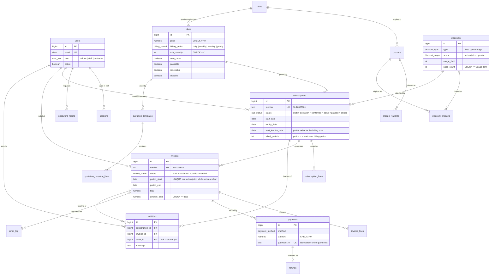

# Brightloop — Subscription Management System

One platform for the full life of a subscription business: products and plans, quotations, subscriptions, automatic recurring invoices, online and manual payments, refunds, email notifications, and a live finance dashboard.

## Features

- **Accounts & roles:** sign up, sign in, password reset by email, change password, admin-only staff creation and account deactivation. Customers see only their own data.
- **Catalog:** products with variants that adjust the price (for example Brand: Odoo adds ₹560), taxes, and plans with billing period, minimum quantity, availability dates and per-plan rules for auto-close, pause, renew and early close.
- **Sales:** quotation templates with a validity window; subscriptions move draft → quotation → confirmed → active ⇄ paused → closed. Customers can also subscribe themselves from the portal.
- **Running subscriptions:** change seats and add-ons, or attach a discount; the change applies from the next invoice.
- **Activity timeline:** every subscription and invoice records who did what and when (quotes sent and accepted, status changes, invoices, payments, refunds, automatic jobs), like Odoo's chatter. Sending a quotation emails the customer a link to accept it in the portal.
- **Billing:** the hourly job invoices every due subscription (plan fee + product lines, taxes and discounts applied) with nothing billed twice or skipped. Invoices can be confirmed, cancelled, emailed or printed.
- **Payments:** staff record payments by method, customers pay online with Razorpay, admins refund. Receipts and overdue reminders (reminder, then final notice) are emailed automatically.
- **Finance:** dashboard with active subscriptions, MRR, revenue net of refunds, outstanding and overdue amounts, filterable by date range and plan, plus CSV export of subscriptions, invoices and payments.
- **Growth intelligence:** the numbers a subscription business is valued on, computed from its own invoices. MRR movements (new, expansion, contraction, churn), net revenue retention, quick ratio, churn, ARPA, gross margin, lifetime value and DSO; a six-month MRR forecast; a what-if simulator showing what cutting churn or growing upsell is worth; and a ranked list of revenue at risk with the reason for each flag.

**Stack:** Node.js + Express 5 · PostgreSQL (raw SQL with `pg`, no ORM) · React 18 + Vite · Server-Sent Events for live updates.
Runtime dependencies are kept to five: `express`, `pg`, `nodemailer`, `react`, `react-router-dom`. Password hashing (scrypt), tokens, validation, cookies, real-time updates and the Razorpay integration (plain `fetch` + HMAC signature checks) use Node built-ins or our own code.

## Run with Docker (one command)

```bash
docker compose up --build
```

Open http://localhost:4000. The first start creates the schema and seeds the demo data; later restarts keep the data (`docker compose down -v` wipes it). To enable online payments or real email, export `RAZORPAY_KEY_ID`/`RAZORPAY_KEY_SECRET` or the `SMTP_*` variables before running.

## Quick start (local)

Requirements: Node 22+, PostgreSQL 14+.

```bash
createdb subscriptions
createdb subscriptions_test          # used by the test suite

cd server
cp .env.example .env
npm install
npm run seed                         # schema + 24 months of demo data (~2,400 subscriptions, ~14,000 invoices)
npm run dev                          # API on http://localhost:4000

cd ../client
npm install
npm run dev                          # UI on http://localhost:5173
```

| Role     | Email                   | Password        |
|----------|-------------------------|-----------------|
| Admin    | admin@brightloop.io     | `Admin@1234`    |
| Staff    | staff@brightloop.io     | `Staff@1234`    |
| Customer | customer@brightloop.io  | `Customer@1234` |

Without SMTP settings, emails (reset links, invoices, receipts, reminders) are printed to the API console. Online payments appear only when `RAZORPAY_KEY_ID` and `RAZORPAY_KEY_SECRET` (test keys) are set in `server/.env`.

Production: `cd client && npm run build`, then `cd server && npm start` serves the API and the built UI from one port.

Load test: with the API running, `cd server && npm run loadtest -- http://localhost:4000 50 20` (URL, concurrent clients, seconds).

Tests: `cd server && npm test` runs pricing unit tests, billing, subscription and payment integration tests, and HTTP-level security tests against `subscriptions_test`.

Schema changes are forward-only SQL files in `server/src/db/migrations`. `npm run migrate` applies the new ones, and `npm run db:reset` rebuilds the demo data.

## Demo walkthrough (about 6 minutes)

Follows the billing month from the brief. Open a second browser window as another role to watch screens update live.

1. **A new customer signs up.** On `/signup`, try a weak password (the rules check off live) and an existing email (rejected), then create an account. Use *Forgot password?* and the reset link appears in the API console.
2. **Roles.** Sign in as staff: Configuration is view-only and *Team* is missing. Sign in as admin to add a staff member or deactivate one.
3. **Launching a plan.** As admin, open *Products* → *CRM Suite* to see the *Brand: Odoo +₹560* variant. Under *Plans*, edit one to show billing period, minimum quantity, availability dates, plan tax, and the auto-close/pause/renew/close rules.
4. **Quote to subscription.** In *Subscriptions → New*, start from the *Enterprise starter* template for any customer. Open the quote: send it, confirm it, activate it, and watch the status bar move through each stage.
5. **Billing day.** On *Invoices*, click *Run billing now*; every due subscription is invoiced (plan fee + products, tax and discount) and running it again creates nothing. Open an invoice to confirm, send, print or cancel it.
6. **A better price.** Under *Discounts*, create one (percentage, minimum quantity, dates, usage limit). On an active subscription, *Apply* it in Details or use *Edit products* to add seats; both take effect on the next invoice.
7. **The money comes in.** On a confirmed invoice, *Record payment* (method, amount, date, note); a partial payment leaves a balance, the rest marks it paid, and a receipt email is logged. As the customer, *Start a subscription* in the portal and pay the first invoice online (needs Razorpay test keys). As admin, refund a payment.
8. **End of the month.** The *Dashboard* shows active subscriptions, MRR, revenue net of refunds, outstanding and overdue, filterable by dates and plan. Use *Invoices → Overdue only* and *Export CSV* for the finance lead.

## Growth intelligence: how it works

Everything is deterministic and runs locally in PostgreSQL and Node. There are no external services and no machine-learning models, so the same data always produces the same numbers, and every figure can be traced back to invoices.

- **MRR** is a snapshot: every non-cancelled invoice whose period covers the date, net of discounts and excluding tax, converted to a monthly amount by its plan's billing period. The dashboard and the Growth page use this single definition.
- **Movements** compare each customer's MRR at consecutive month-ends: from zero is *new*, up is *expansion*, down is *contraction*, to zero is *churn*. This happens in one SQL query with window functions.
- **KPIs** use the last three complete months: churn is customers lost ÷ customers at the start; quick ratio is (new + expansion) ÷ (contraction + churn); net revenue retention is the monthly retained-plus-expansion rate compounded over 12 months; lifetime value is ARPA × gross margin ÷ churn, with gross margin taken from product cost prices.
- **Forecast** uses Holt's linear trend method with damping. Its smoothing parameters come from an exhaustive grid search on one-step-ahead error, and the 80% range comes from the in-sample residuals. The typical error shown is the in-sample mean absolute percentage error.
- **Simulator** projects MRR month by month as MRR × (1 + expansion − contraction − churn) + new business, starting from the measured rates. The sliders change those rates, so each lever's value is visible in rupees.
- **Revenue at risk** applies transparent rules with fixed weights: overdue 1/14/30+ days, a paused subscription, spend dropped since last month, contract ending within 30 days, a recent refund. Customers scoring 20 or more are listed, with the reasons.

The demo data comes from a fixed-seed generator (24 months, growing acquisition, about 2.5% monthly churn, add-ons that start and stop), so `npm run db:reset` always rebuilds the same business.

## Database design

PostgreSQL enforces the business rules, not only the app: enums for every status, `CHECK`s on money, percentages, dates and usage limits, `citext` unique emails, real foreign keys everywhere (no generic entity-type/id pairs), and a partial unique index so a subscription can never be billed twice for the same period. Seven forward-only migrations live in `server/src/db/migrations`.



## Architecture

```
server/src
├── app.js, server.js, jobs.js     HTTP app, entry point, hourly billing/expiry job
├── config.js                      all environment configuration
├── db/                            pool + transaction helper, migrations, seed
├── lib/                           framework-free logic: validation, pricing, dates, errors, mail, events
├── middleware/                    session auth + role guards, rate limiting, error mapping
└── modules/<feature>/
    ├── routes.js                  HTTP: validate input, check role, call service, publish event
    └── service.js                 business rules + SQL, no req/res
client/src
├── api/                           fetch wrapper with typed errors
├── hooks/                         auth, live updates, data fetching, URL filters, toasts
├── components/                    shared UI kit, layout, line editor
└── pages/                         one folder per feature
```

Each request goes **route → validate → service → SQL**. Services never see `req`/`res`, so billing runs the same way from an HTTP call or the scheduler.

### Key decisions

- **The database enforces the invariants.** Enums for every status, `CHECK` constraints on money, dates, percentages and usage limits, `citext` unique emails, and a partial unique index `invoices(subscription_id, period_start) WHERE status <> 'cancelled'`, so nothing can be billed twice even if two billing runs race.
- **Billing is idempotent and isolated.** Each subscription is invoiced in its own transaction under `SELECT … FOR UPDATE`. Periods are computed from `start_date + n × period` (no month-end drift), and missed periods are caught up. One failing subscription never blocks the rest.
- **Prices are computed server-side.** Unit price = product price + variant extra. Clients send only product, variant and quantity. Money is calculated in integer cents; discounts are spread proportionally across lines so tax applies to the discounted amount.
- **Discounts apply themselves.** A discount attached to a subscription is checked on every invoice (date window, usage limit, minimum amount/quantity, product scope), counted when used, and given back if the invoice is cancelled.
- **Security.** Sessions are random 256-bit tokens stored as SHA-256 hashes in an `httpOnly`, `SameSite=Lax` cookie. Passwords use scrypt with per-user salt. Reset tokens are single-use, hashed, and expire after 30 minutes; a reset revokes all sessions. Auth endpoints are rate limited, and every query is parameterised. Customers are scoped to their own records in the service layer, and other customers' records return 404 rather than 403.
- **Real time without a library.** Mutations publish a tiny `{topic, id}` event through PostgreSQL `NOTIFY`; every API instance `LISTEN`s and forwards it over SSE. Clients re-fetch through the normal authorised API, so no data leaks through the event stream.
- **Performance.** Measured on the seeded ~2,400 subscriptions and ~14,000 invoices: lists and detail pages take 2–5 ms (4 queries per detail page), the dashboard about 25 ms, and the full Growth analysis about 55 ms.
  - *Indexes follow the queries:* every foreign key that is filtered on has one, the billing scan uses a partial index of active subscriptions, and `%text%` search uses `pg_trgm` GIN indexes.
  - *Keyset pagination:* each page continues from the last row's sort key (`(paid_on, id) < (...)` for payments), so page 400 costs the same as page 1. The total is counted once, on the first page, and stops at 10,000.
  - *Rollups:* completed month-end MRR is stored in `mrr_snapshots`; Growth computes only today's figure live. Billing or cancelling an invoice for a past period invalidates exactly the affected months.
  - *Fewer round trips:* invoice and subscription lines are written with one `INSERT … SELECT unnest(…)` statement, and a discount is read and locked in one query, so billing takes 8 queries per invoice.
- **Load test.** 50 concurrent clients on a realistic read mix (dashboard, Growth, lists, search, detail pages) against one Node process on a laptop, with request logging on:

  | | Requests/s | p50 | p95 | p99 | Errors |
  |---|---|---|---|---|---|
  | All endpoints | 2,100 | 17 ms | 73 ms | 124 ms | 0 |
  | Subscription page | 470 | 23 ms | 56 ms | 68 ms | 0 |
  | Growth analysis | 120 | 101 ms | 138 ms | 157 ms | 0 |
- **Reliability.**
  - *Transactional outbox for email:* emails are written to an `outbox` table inside the transaction that caused them, so a rolled-back change never emails anyone and a committed one is delivered even if the process crashes or SMTP is down. Workers claim rows with `SKIP LOCKED` and retry with exponential backoff (30 s up to 1 h, 8 attempts); failures stay visible with their last error.
  - *Idempotency keys:* payments, refunds, subscription creation and manual invoicing accept an `Idempotency-Key` header. A retry replays the stored response instead of recording a second payment, and a failed request frees the key for a corrected retry. The UI sends one key per form.
  - *One business timezone (`APP_TIMEZONE`):* every database connection runs in it and Node computes "today" in it, so billing days, due dates and overdue checks never disagree around midnight.
- **Operability.** Every response carries an `X-Request-Id` (passed through from a proxy or generated), each request is logged as one JSON line (id, method, path, status, duration, user), and 500 responses return the id so a user report maps to one log line. `/api/health` is liveness and `/api/ready` checks the database, for load balancers and the Docker health check. GitHub Actions runs the server tests against PostgreSQL and builds the client on every push and pull request.
- **Horizontal scaling with Postgres only.** Any number of API instances can run behind a load balancer:
  - The hourly job takes `pg_try_advisory_lock`, so exactly one instance does the work.
  - Billing workers claim due subscriptions with `FOR UPDATE SKIP LOCKED`, so they run in parallel without waiting on or double-billing each other.
  - Rate limits live in an `UNLOGGED` table with an atomic upsert counter.
  - Live updates fan out through `LISTEN/NOTIFY`.
  - Expired sessions, reset tokens, rate-limit windows, idempotency keys and delivered outbox rows are purged hourly.
  - No Redis, queue or cache server is needed; when one database is no longer enough, read replicas and PgBouncer are the next step.

### Subscription lifecycle

`draft → quotation → confirmed → active ⇄ paused → closed`. Pause, renew and early close are allowed per plan. Plans with `auto_close` close automatically at expiry. Confirmed subscriptions activate on their start date. Quotations expire after their template's validity window.

### Roles

| Capability                                    | Admin | Staff | Customer |
|-----------------------------------------------|:-----:|:-----:|:--------:|
| Products, plans, taxes, discounts             | ✔     | view  |          |
| Add staff / admins, deactivate accounts, refund payments | ✔ |  |          |
| Customers, subscriptions, templates, invoices, record payments, apply discounts | ✔ | ✔ | |
| Own subscriptions, invoices, payments; subscribe; pay online |  |  | ✔        |
| Accept quote, change products, pause / resume / renew / close (if plan allows) | ✔ | ✔ | ✔ |
